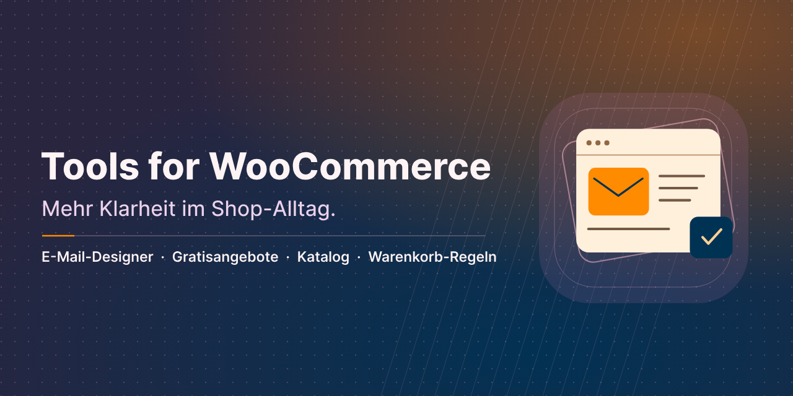
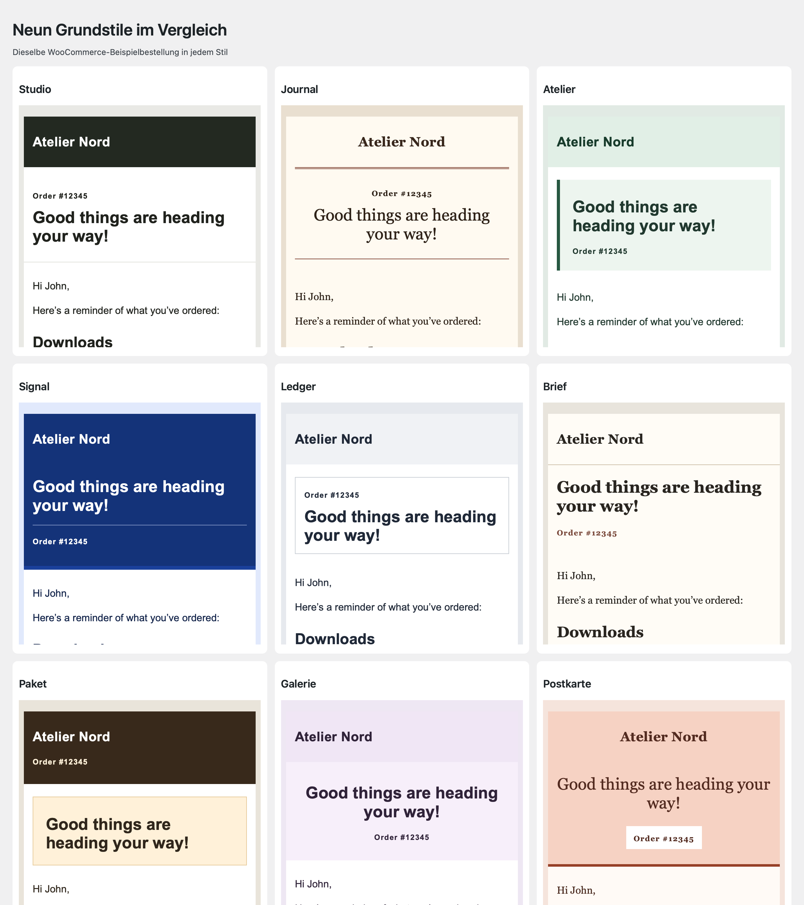

# Tools for WooCommerce

[English](README.md)

Tools for WooCommerce ergänzt WooCommerce um eine ruhigere Arbeitsoberfläche und klar einstellbare Shop-Funktionen. Regulärer Verkauf, kostenlose Angebote, Präsentationskatalog und Bestellgrenzen lassen sich passend zum jeweiligen Shop konfigurieren.

Version 1.0.0 · WordPress ab 7.0 · PHP ab 8.3 · WooCommerce ab 11.1.2

[Auf einen Blick](#section-0) · [Installation und erste Schritte](#section-1) · [Funktionen und Bedienung](#section-2) · [Voraussetzungen und Grenzen](#section-3) · [FAQ](#section-4) · [Änderungsverlauf](#section-5) · [Über das Projekt](#section-6) · [Hilfe und Sicherheit](#section-7)

## Auf einen Blick

- WooCommerce-Menüs aufräumen und auf Wunsch Shop-Alltag und Verwaltung trennen.
- WooCommerce-Standardmails mit Grundstilen, Dynamic Tags, Live-Vorschau und Testversand gestalten.
- Kostenlosen Materialversand oder kostenlose Downloads einrichten und optional auf freiwillige Unterstützung hinweisen.
- Produkte als Katalog mit direktem Kontaktweg präsentieren.
- Warenkorb und Bestellung auf genau ein Stück oder eigene Mengen- und Wertgrenzen beschränken.
- Einstellungen und E-Mail-Designs gemeinsam oder getrennt zwischen TfWC-Installationen übertragen.

- Shop-Einstellungen, Zahlungsarten und E-Mail-Vorlagen über die Übersicht direkt öffnen. Shop-Seiten, Versandzonen, Produkte, Gutscheine und Bestellungen prüfen.

### Feature-Highlights

- **Shop-Mails im eigenen Design.** Einen Grundstil wählen, Kopf- und Fußbereich gestalten und passende Dynamic Tags direkt am Textfeld einfügen. Vorschau, Testmail und Veröffentlichung sind eigene Schritte.
- **Gratisangebote mit passendem Bestellablauf.** Material versenden oder Dateien bereitstellen, jeweils für 0 €. Ein freiwilliger Unterstützungshinweis kann auf ein externes Angebot verweisen.
- **Genau ein Exemplar pro Bestellung.** Eine Regel begrenzt den gesamten Warenkorb auf ein Stück. Für andere Angebote lassen sich Mengen- und Wertgrenzen einstellen.
- **Kürzere Wege im Shop-Admin.** Empfehlungen reduzieren und das WooCommerce-Menü auf Wunsch in Tagesgeschäft und Verwaltung aufteilen.

## Installation und erste Schritte

1. PHP ab 8.3, WordPress ab 7.0 und WooCommerce ab 11.1.2 verwenden.
2. Ein bisheriges Bereinigungs-Snippet oder die frühere Purify-WooCommerce-Testfassung deaktivieren.
3. Das ZIP unter Plugins → Installieren → Plugin hochladen installieren und aktivieren.
4. WooCommerce → Tools for WooCommerce öffnen. Ohne aktives WooCommerce liegt die Seite unter Einstellungen; die Shop-Funktionen pausieren, Einstellungen bleiben vorbereitbar.
5. Einen passenden Ausgangspunkt anwenden und die einzelnen Schalter anschließend speichern.

Beim manuellen Wechsel auf den neuen Pluginordner werden vorhandene alte Website-Einstellungen gelesen, solange noch keine neue Konfiguration gespeichert wurde. Es werden keine Produkte oder Bestellungen migriert. Alte und neue Implementierung nicht gleichzeitig betreiben.

## Funktionen und Bedienung

### Aufgeräumter Shop

Werbeempfehlungen, Marketing-/Umfragenotizen, Einrichtungsaufgaben und Bewertungsaufforderungen einzeln reduzieren. Die Standardkonfiguration erhält reguläre Käufe, Zahlungsarten und alle Admin-Einstiege. Menüausblendung ist separat: ein ausgeblendetes Zahlungsmenü schaltet keine Zahlungsart ab. Kundenverwaltung und gemeinsame WooCommerce-App bleiben verfügbar.

### Kostenlose Angebote

Die Voreinstellung „Kostenlose Angebote“ hat die Varianten physischer Versand und Downloads. Sie setzt alle Plugin-Schalter bewusst neu; „Individuell“ erhält gespeicherte Werte. Der Admin-Name lässt sich beispielsweise an einen Materialversand anpassen.

Physische Produkte benötigen expliziten Preis 0, die Produkttypen physisch/nicht herunterladbar und eine echte kostenlose Versandart ohne Bedingungen. Lieferadresse und Versandposition werden geprüft; Telefon und bestehende Kontoeinstellungen bleiben erhalten. WooCommerce setzt solche Bestellungen normalerweise auf „In Bearbeitung“, bis der Versand abgeschlossen wird.

Downloads benötigen Preis 0, die Merkmale virtuell und herunterladbar sowie konfigurierte Dateien. Die native Downloadverwaltung bleibt erreichbar. WooCommerce übernimmt Abschluss, Downloadberechtigungen und Auslieferung. Dateischutz, Anmeldepflicht, Downloadlimits und Ablauf werden in WooCommerce eingerichtet. Die kostenlosen Varianten erlauben keine gemischten Warenkörbe.

### Freiwillige Unterstützung

Optional einen Spenden-/Trinkgeldhinweis und einen externen Link eintragen. Klassische Shop-, Produkt-, Warenkorb-, Checkout- und Bestätigungsseiten können ihn anzeigen. Native Warenkorb-/Checkout-Blöcke erhalten die gewählten Hinweise ebenfalls; in eigenen Layouts steht `[twc_support_notice]` für einen Shortcode-Block bereit. Das Plugin erhebt keine Zahlung und fügt keine Gebühr hinzu.

### Katalog

Katalogbetrieb zeigt Produkte und sperrt neue Käufe im Shop, auch über die Store API und für Administratoren. Preise können sichtbar bleiben oder ausgeblendet werden. Eigener Erklärungstext und Kontaktlink können auf eine vorhandene Kontaktseite oder ein Anfrageformular verweisen. `[twc_catalog_notice]` ist für eigene Layouts verfügbar. Es wird kein eigenes Anfrageformular oder Anfragearchiv angelegt. Bestehende Bestellungen und Kundenkonten bleiben erhalten. Nach einem Wechsel Seiten-Caches leeren.

### Warenkorb-Regeln

„Grenzen für Warenkorb und Bestellung aktivieren“ einschalten. Für genau ein Exemplar zusätzlich „Genau ein Artikel“ wählen. Dann ist insgesamt ein Stück zulässig; alle anderen Mengen-/Wertregeln sind nachrangig.

Alternativ Mindest-/Höchstmenge der gesamten Bestellung, Mindest-/Höchstmenge je Produkt oder Variante, Mengenschritt und Mindest-/Höchstproduktwert einstellen. 0 bedeutet keine Grenze, ein Mengenschritt beginnt bei 1. Gleiche Varianten in mehreren Warenkorbzeilen werden für Produktgrenzen zusammengezählt. Beträge beziehen sich auf den Produktwert nach Rabatten ohne Steuern, Versand und Gebühren in der Shop-Währung. Mindestwerte werden beim Checkout geprüft; Höchstmengen und Mengenschritte zusätzlich beim Hinzufügen/Ändern. Native Mengenfelder können sich nach den ausgewählten Grenzen richten.

### Mehrere Websites und Daten

Einstellungen gelten pro Website, auch bei Netzwerkaktivierung. Der JSON-Export überträgt nur Plugin-Einstellungen, keine WooCommerce-Einrichtung, Produkte oder Bestellungen. Import ersetzt die aktuelle Konfiguration; Berechtigung und Sicherheitsprüfung sind erforderlich. Deaktivierung erhält alle Daten. Deinstallation erhält Plugin-Einstellungen standardmäßig; die eigene Löschoption kann sie je Website entfernen. Produkte, Bestellungen und Daten anderer Plugins bleiben immer erhalten.

## Voraussetzungen und Grenzen

Die neuen Bestellregeln greifen im klassischen WooCommerce-Checkout und in der Store API. Admin-Importe, individuelle Bestell-APIs und Abonnements-/Bundle-Erweiterungen sind keine allgemeine Schutzgrenze dieses Plugins. Komplexe zusammengesetzte Produkte sind gesondert zu testen.

Firmenfeld und angepasste Checkout-Überschriften betreffen den klassischen Checkout. Block-Felder/-Beschriftungen und besondere Builder-Layouts können eigene Einstellungen benötigen. Drittanbieter-Werbung und sämtliche Remote-Anfragen werden nicht pauschal blockiert. Ein später durch ein Fremdplugin ausgelöster Bestellfehler kann bereits eine offene Bestellung oder Reservierung hinterlassen.

Das Add-on bleibt ohne WooCommerce aktivierbar: abhängige Shop-Funktionen pausieren, die sichere Einstellungsseite bleibt erreichbar. Getestete Umgebungen und Grenzen stehen im lokalen Prüfbericht; keine ungeprüfte Multisite- oder Hosting-Garantie.

## FAQ

### Kann der Shop weiterhin regulär verkaufen?
Ja. „Aufgeräumter Shop“ erhält normalen Verkauf und Zahlungsarten.

### Wie erlaube ich genau ein Buch oder einen Artikel?
Warenkorb-Regeln aktivieren und „Genau ein Artikel“ einschalten. Es ist ein Stück insgesamt zulässig.

### Werden Spenden im Checkout abgerechnet?
Nein. Der Hinweis ist freiwillige Information; ein optionaler Link führt zu einem externen Unterstützungsangebot.

### Kann ich kostenlose Downloads und Versandprodukte mischen?
Die kostenlosen Varianten sind getrennt. Im regulären Bestellbetrieb gelten weiterhin die WooCommerce-Funktionen.

### Gibt es ein Anfrageformular im Katalog?
Der Katalog bietet einen konfigurierbaren Kontaktlink zu einer vorhandenen Seite oder einem Formular.

### Was passiert mit meinen bisherigen Einstellungen?
Die neue Fassung liest die alte Konfiguration, bis neue Einstellungen gespeichert werden. Die alte Pluginfassung und das Snippet vorher deaktivieren.

### Was passiert bei Deinstallation?
Einstellungen bleiben standardmäßig erhalten. Nur bei aktivierter Löschoption werden eigene Website-Einstellungen entfernt; Produkte und Bestellungen bleiben erhalten.

## Änderungsverlauf

### 1.0.0 — 2026-11-13

- Dauerhafte Vorschauoptionen für Bestelldaten und externe Bilder. Fehlende deutsche Beschriftungen in der Einstellungsübersicht ergänzt.

- Shop-Einstellungsübersicht mit Direkteinstiegen, optionalem Menüeintrag und Prüfungen für Shop-Seiten und Versandzonen.
- E-Mail-Designer mit WooCommerce-Branding-Übernahme, Bestätigungsmail und Germanized-Vorlagen.
- Kaufbarkeits-, Gutschein- und Bestellstatusprüfung sowie kompaktere Admin-Navigation.

### 0.3.0 — 2026-11-10
- **Neu:** Katalogbetrieb mit optional ausgeblendeten Preisen, Erklärung und Kontaktlink.
- **Neu:** Warenkorb-Regeln für genau einen Artikel, Mindest-/Höchstmengen, Produktwerte und Mengenschritte.
- **Neu:** Optionale freiwillige Unterstützungshinweise für kostenlose physische Produkte und Downloads.
- **Neu:** Export/Import der Einstellungen und wahlweises Löschen der Website-Einstellungen.
- **Verbessert:** Umbenennung in Tools for WooCommerce mit neuem Pluginordner, neuer Textdomain und neuen Code-Präfixen; bisherige Einstellungen bleiben lesbar.
- **Verbessert:** Gemeinsame Update- und Plugin-Library-Komponenten aktualisiert; benötigt PHP 8.3.
- **Behoben:** Regulären Verkauf als Standard erhalten und Speicherbestätigung einmalig anzeigen.

### 0.2.0 — 2026-10-06
- **Neu:** Voreinstellungen Aufgeräumter Shop, Kostenlose Angebote und Individuell mit getrennten Versand- und Downloadvarianten.
- **Verbessert:** Werbung, Admin-Einstiege, Namen, Icons und Bestellboxen separat steuern; alte Konfiguration erhalten.
- **Verbessert:** Kostenlose Produkttypen, konfigurierte Downloads, Versand und Gebühren ungleich null prüfen.

### 0.1.0 — 2026-10-06
- **Neu:** Reversible WooCommerce-Bereinigung und geschützte kostenlose physische Bestellungen.
- **Neu:** Website-Einstellungen, optionale klassische Checkout-Texte und gemeinsame deckerweb-Anbindungen.

## Über das Projekt

Entwickelt und herausgegeben von David Decker – DECKERWEB. Tools for WooCommerce verbindet gezielte Shop-Bereinigung mit optionalen Werkzeugen für unterschiedliche Verkaufs- und Angebotsmodelle.

## Hilfe und Sicherheit

[Issues](https://github.com/deckerweb/tools-for-woocommerce/issues) · [Discussions](https://github.com/deckerweb/tools-for-woocommerce/discussions) · [Security](https://github.com/deckerweb/tools-for-woocommerce/blob/main/SECURITY-de.md) · [Ko-fi](https://ko-fi.com/deckerweb)

© 2026 David Decker – DECKERWEB. Plugin: GPL v2 or later / GPL-2.0-or-later.

[Plugin-Website](https://deckerwebplugins.com/de/plugins/tools-for-woocommerce/) · [LICENSE](LICENSE)
