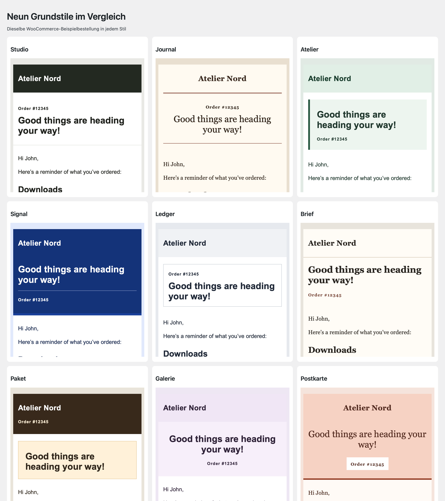

# Tools for WooCommerce

[Deutsch](README-de.md)

Tools for WooCommerce adds a calmer workspace and clearly configurable store features to WooCommerce. Regular sales, free offers, a presentation catalog and order limits can be configured for each store.

Version 1.0.0 · WordPress 7.0+ · PHP 8.3+ · WooCommerce 11.1.2+

[At a glance](#section-0) · [Installation and first steps](#section-1) · [Features and usage](#section-2) · [Requirements and limits](#section-3) · [FAQ](#section-4) · [Changelog](#section-5) · [About the project](#section-6) · [Help and security](#section-7)

## At a glance

- Tidy WooCommerce menus and optionally split everyday shop tasks from management.
- Design WooCommerce core emails with base styles, dynamic tags, live previews and test sends.
- Set up free shipping offers or free downloads and optionally link to a way to support your work.
- Present products as a catalog with a direct way to get in touch.
- Limit carts and orders to one unit or set your own quantity and value limits.
- Transfer settings and email designs together or separately between TfWC installations.

- Open settings, payment methods and email templates directly from the overview. Check shop pages, shipping zones, products, coupons and orders.

### Feature highlights

- **Shop emails in your own design.** Choose a base style, customize the header and footer, and insert relevant dynamic tags directly in text fields. Previewing, test sends and publishing are separate steps.
- **A checkout for free offers.** Ship materials or provide downloads at zero cost. An optional support message can link to an external page.
- **Exactly one copy per order.** One rule limits the entire cart to one unit. Use quantity and value limits for other offers.
- **Shorter paths in shop admin.** Reduce recommendations and optionally split the WooCommerce menu into everyday tasks and management.

## Installation and first steps

1. Use PHP 8.3+, WordPress 7.0+ and WooCommerce 11.1.2+.
2. Deactivate a previous cleanup snippet or the earlier Purify WooCommerce test build.
3. Upload the ZIP through Plugins → Add New → Upload Plugin and activate it.
4. Open WooCommerce → Tools for WooCommerce. Without active WooCommerce, find it under Settings; store features pause while configuration remains available.
5. Apply a suitable starting point, then save individual adjustments.

When manually switching to the new plugin folder, previous website settings are read until a new configuration is saved. Products and orders are not migrated. Do not run the old and new implementations together.

## Features and usage

### Tidy shop

Reduce advertising recommendations, marketing/survey notes, onboarding tasks and review prompts individually. Defaults preserve regular purchases, gateways and admin entry points. Menu visibility is separate: hiding payment menus does not disable gateways. Customers and the shared WooCommerce app remain accessible.

### Free offers

The Free offers preset has physical-shipping and download variants. Applying it deliberately replaces all plugin switches; Individual retains saved values. The admin name is editable for a material-distribution service, for example.

Physical products need explicit price 0, nonvirtual/nondownloadable product settings and a real free shipping method without conditions. Shipping lines and addresses are checked; phone and account settings remain. WooCommerce normally sets these orders to Processing until dispatch.

Downloads need price 0, virtual/downloadable flags and configured files. Native download administration remains accessible. WooCommerce handles completion, permissions and delivery. Configure protection, login requirements, download limits and expiry in WooCommerce. Free variants do not allow mixed carts.

### Voluntary support

Optionally enter donation/tip information and an external link. Classic shop, product, cart, checkout and order confirmation templates can display it. Native Cart/Checkout blocks also receive the selected notice; use `[twc_support_notice]` in a Shortcode block for custom layouts. The plugin collects no payment and adds no order fee.

### Catalog

Catalog mode shows products but blocks new storefront purchases, including Store API purchases and administrators. Prices can remain visible or be hidden. An optional explanation and contact link can point to an existing contact page or inquiry form. Use `[twc_catalog_notice]` for custom layouts. No new inquiry form or archive is created. Existing orders and customer accounts remain. Clear page caches after switching modes.

### Cart Rules

Enable cart and order limits. For exactly one copy, also select Exactly one item. This allows one unit in total and overrides the other quantity/value rules.

Alternatively set minimum/maximum total order quantity, minimum/maximum quantity per product or variation, quantity increment and minimum/maximum product value. Zero means no limit; increments start at 1. The same variation split into multiple cart rows is aggregated for product limits. Amounts use product value after discounts, excluding tax, shipping and fees, in the shop currency. Minimums apply at checkout; maximum quantities/increments also apply when adding/updating items. Native quantity inputs may reflect the chosen bounds.

### Multiple websites and data

Configuration is website-local, including network activation. JSON transfer includes only plugin settings, not WooCommerce setup, products or orders. Import replaces the current configuration and requires administrator access and nonce verification. Deactivation retains all data. Uninstall retains plugin settings by default; an opt-in per-site setting removes them. Products, orders and other plugins’ data are always retained.

## Requirements and limits

Order rules apply to classic WooCommerce checkout and Store API. Admin imports, custom order APIs and subscription/bundle extensions are outside a general enforcement guarantee. Test complex composite products separately.

Company-field removal and modified checkout captions target classic checkout. Block fields/captions and custom builder layouts can require their own configuration. Third-party advertising and all remote requests are not globally blocked. Late failures introduced by other plugins can leave pending orders or reservations.

The add-on remains activatable without WooCommerce: dependent store features pause and the safe settings screen remains accessible. Tested environments and limits are in the local validation report; no untested multisite or hosting guarantee.

## FAQ

### Can the store still sell normally?
Yes. Tidy shop retains regular sales and gateways.

### How do I allow exactly one book or item?
Enable Cart Rules and select Exactly one item. One unit in total is allowed.

### Are donations charged at checkout?
No. The notice is voluntary information; an optional link leads to an external support service.

### Can free downloads and shipped products be mixed?
Free variants are separate. Regular order mode retains WooCommerce functionality.

### Does the catalog provide an inquiry form?
It provides a configurable link to an existing contact page or form.

### What happens to earlier settings?
The new build reads the old configuration until new settings are saved. Deactivate the previous plugin and snippet first.

### What happens on uninstall?
Settings remain by default. Only the opt-in deletion setting removes this plugin’s website configuration; products and orders remain.

## Changelog

### 1.0.0 — 2026-11-13

- Persistent preview options for order data and external images. Added missing German settings overview labels.

- Shop settings overview with direct links, an optional menu entry, and checks for shop pages and shipping zones.
- Email Designer with WooCommerce branding import, address verification email, and Germanized templates.
- Purchase, coupon and order status checks, plus streamlined admin navigation.

### 0.3.0 — 2026-11-10
- **New:** Catalog mode with optional hidden prices, an explanatory message and a contact link.
- **New:** Cart Rules for exactly one item, minimum/maximum quantities, product values and quantity increments.
- **New:** Optional voluntary support messages for free physical products and downloads.
- **New:** Settings export/import and opt-in deletion of website settings.
- **Improved:** Renamed to Tools for WooCommerce with a new plugin folder, textdomain and code prefixes; earlier settings remain readable.
- **Improved:** Updated shared update and plugin-library components; requires PHP 8.3.
- **Fixed:** Preserved regular sales by default and displayed one settings-save confirmation.

### 0.2.0 — 2026-10-06
- **New:** Tidy shop, Free offers and Individual presets, with separate physical-shipping and download variants.
- **Improved:** Separate advertising, admin screens, names, icons and order boxes; preserve earlier configuration.
- **Improved:** Validate free-product types, configured downloads, shipping and nonzero fees.

### 0.1.0 — 2026-10-06
- **New:** Reversible WooCommerce cleanup and guarded free physical orders.
- **New:** Site settings, optional classic checkout text and shared deckerweb integrations.

## About the project

Developed and published by David Decker – DECKERWEB. Tools for WooCommerce combines targeted store cleanup with optional tools for different sales and free-offer models.

## Help and security

[Issues](https://github.com/deckerweb/tools-for-woocommerce/issues) · [Discussions](https://github.com/deckerweb/tools-for-woocommerce/discussions) · [Security](https://github.com/deckerweb/tools-for-woocommerce/blob/main/SECURITY.md) · [Ko-fi](https://ko-fi.com/deckerweb)

© 2026 David Decker – DECKERWEB. Plugin: GPL v2 or later / GPL-2.0-or-later.

[Plugin website](https://deckerwebplugins.com/en/plugins/tools-for-woocommerce/) · [LICENSE](LICENSE)
