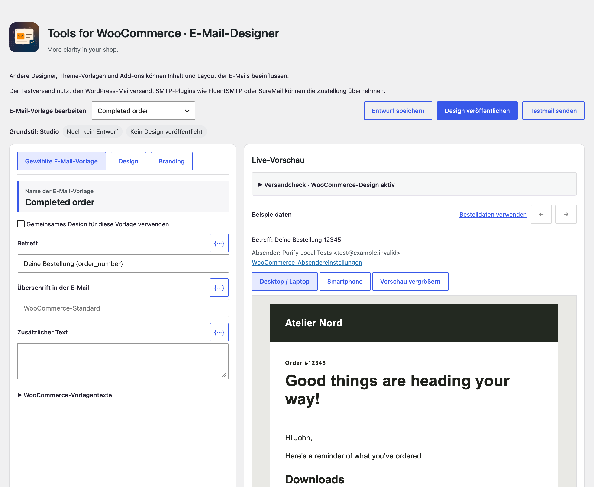

# Startseite

[English](Home)

Tools for WooCommerce ergänzt WooCommerce um eine ruhigere Arbeitsoberfläche und klar einstellbare Shop-Funktionen. Regulärer Verkauf, kostenlose Angebote, Präsentationskatalog und Bestellgrenzen lassen sich passend zum jeweiligen Shop konfigurieren.

Version 1.0.0 · WordPress ab 7.0 · PHP ab 8.3 · WooCommerce ab 11.1.2

- WooCommerce-Menüs aufräumen und auf Wunsch Shop-Alltag und Verwaltung trennen.
- WooCommerce-Standardmails mit Grundstilen, Dynamic Tags, Live-Vorschau und Testversand gestalten.
- Kostenlosen Materialversand oder kostenlose Downloads einrichten und optional auf freiwillige Unterstützung hinweisen.
- Produkte als Katalog mit direktem Kontaktweg präsentieren.
- Warenkorb und Bestellung auf genau ein Stück oder eigene Mengen- und Wertgrenzen beschränken.
- Einstellungen und E-Mail-Designs gemeinsam oder getrennt zwischen TfWC-Installationen übertragen.

[Getting started / Erste Schritte](Getting-started-de) · [User guide / Anleitung](User-guide-de) · [FAQ](FAQ-de)
