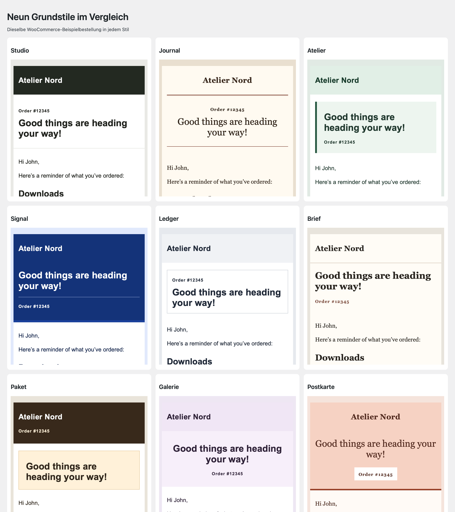
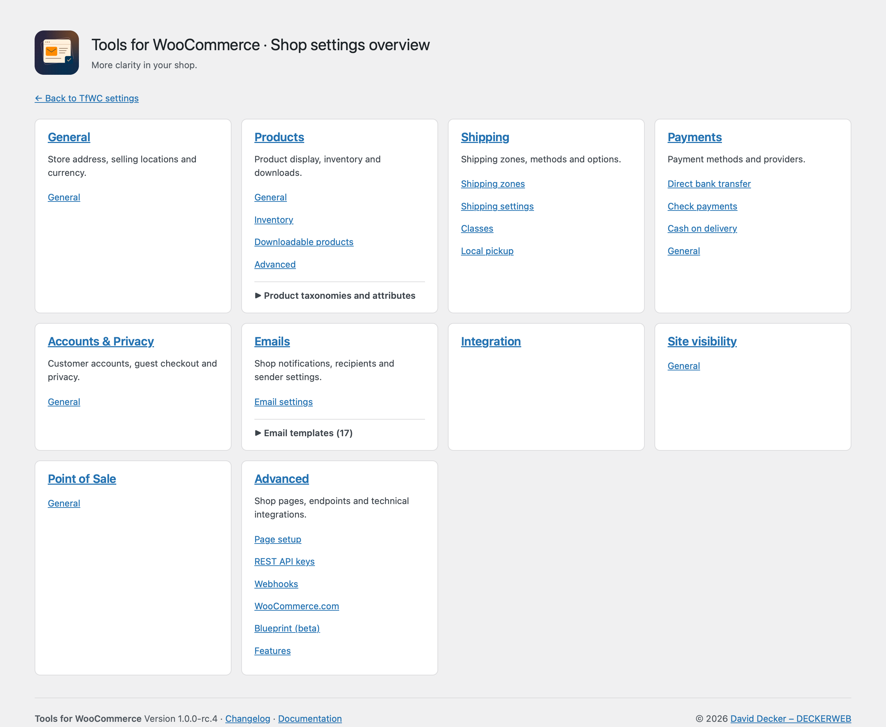
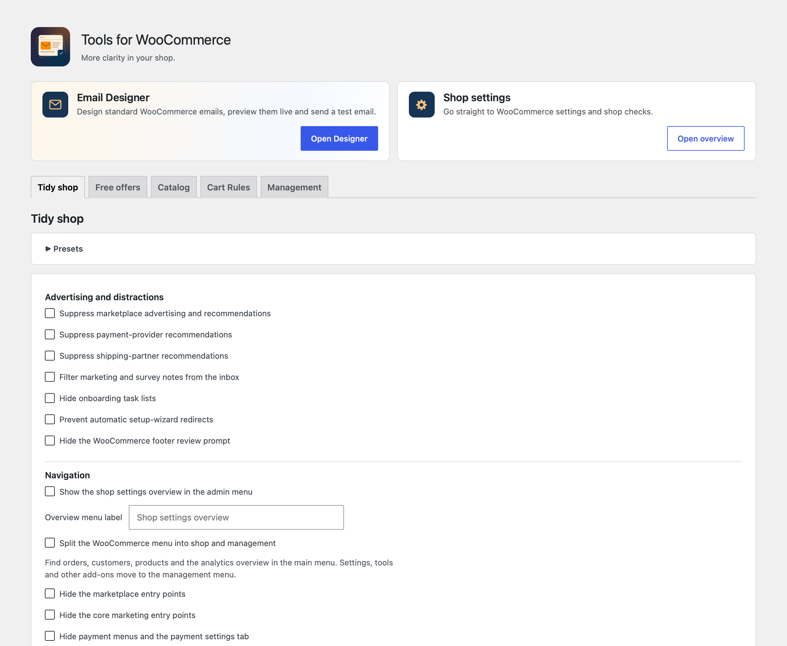
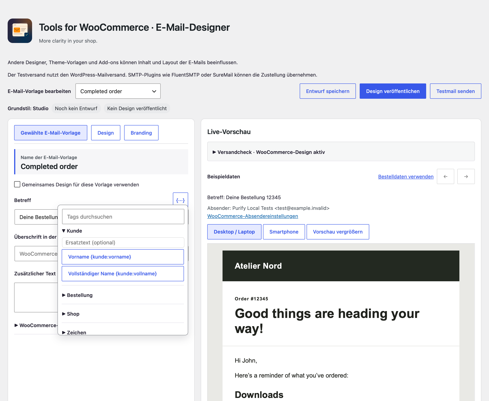
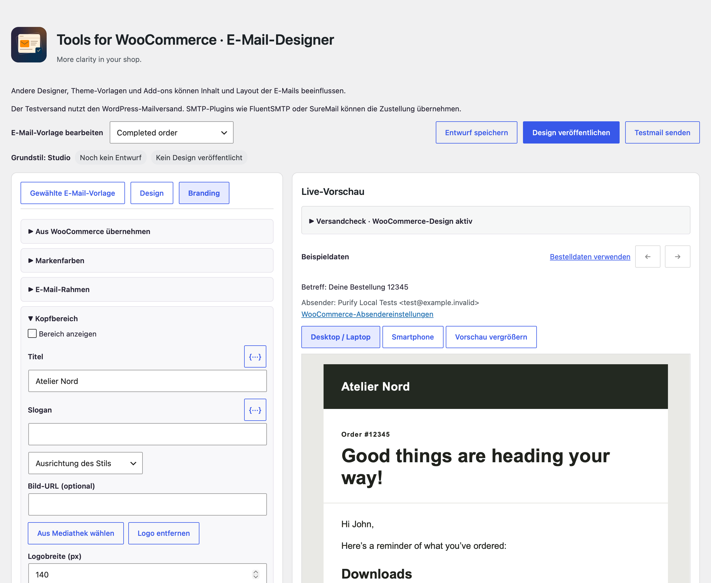
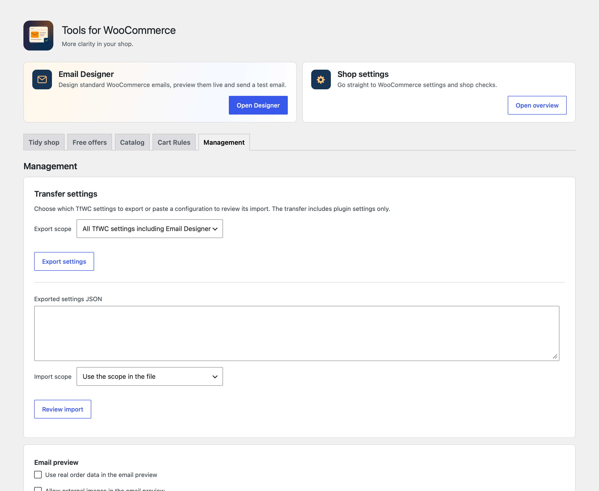
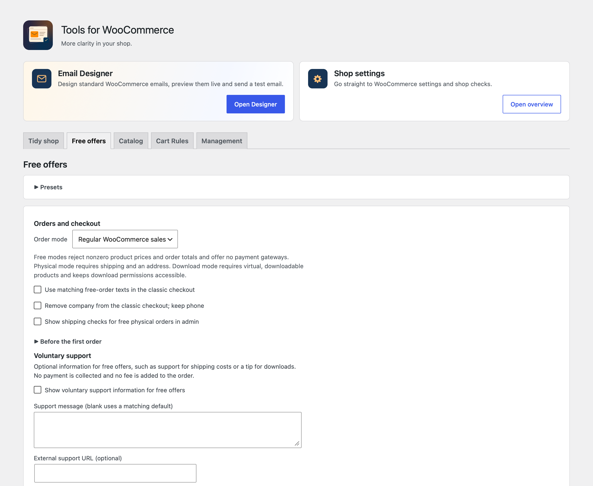
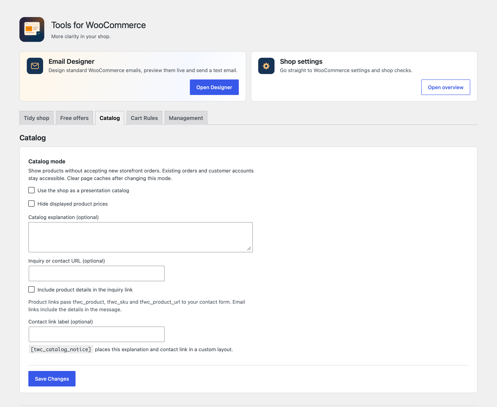
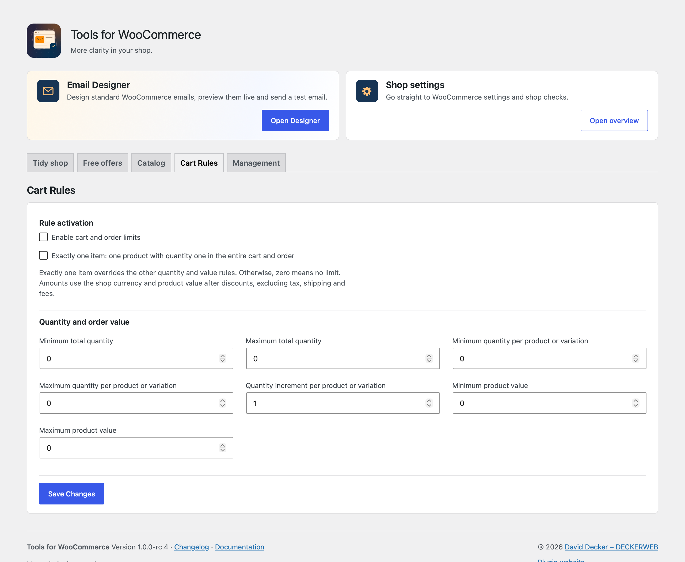

# Anleitung

[English](User-guide)

### Aufgeräumter Shop

Werbeempfehlungen, Marketing-/Umfragenotizen, Einrichtungsaufgaben und Bewertungsaufforderungen einzeln reduzieren. Die Standardkonfiguration erhält reguläre Käufe, Zahlungsarten und alle Admin-Einstiege. Menüausblendung ist separat: ein ausgeblendetes Zahlungsmenü schaltet keine Zahlungsart ab. Kundenverwaltung und gemeinsame WooCommerce-App bleiben verfügbar.

Optional teilt **Aufgeräumter Shop → Navigation** das WooCommerce-Menü. Bestellungen, Kunden, verfügbare Zahlungen und Abonnements, Analysen und Produkte liegen im Kernmenü. Shop-Einstellungen, klassische Berichte und weitere Werkzeuge stehen unter Verwaltung.

### E-Mail-Designer

Den Designer über die Karte oberhalb der TfWC-Einstellungen öffnen. E-Mail-Vorlage und Grundstil auswählen, Texte mit Dynamic Tags anpassen und unter **Branding** Kopf- und Fußbereich gestalten. Die Vorschau zeigt je nach Vorlage Beispieldaten oder Bestelldaten. Den Entwurf speichern, am Desktop und in der Smartphone-Vorschau prüfen und bei Bedarf eine Testmail senden. **Design veröffentlichen** aktiviert die Gestaltung für die im Designer ausgewählten Vorlagen. WooCommerce steuert weiterhin, welche Benachrichtigungen aktiviert sind und wann sie verschickt werden.

Unter **Branding → Aus WooCommerce übernehmen** lassen sich gespeicherte Farben, Kopfzeilenlogo, Logobreite, Ausrichtung und Fußzeilentext auswählen und in den Entwurf kopieren. Kopf- und Fußlogo haben getrennte Breiten. **Palette auf Grundstil zurücksetzen** entfernt die eigenen Farbwerte des Entwurfs. Die Vorschau zeigt die in WooCommerce hinterlegten Absenderdaten. Bei der E-Mail-Adressbestätigung verwendet die Vorschau Beispieldaten. Im regulären Versand erzeugt WooCommerce den Bestätigungslink.

### WordPress-Integration

Die WordPress-Befehlspalette findet die TfWC-Einstellungen und den E-Mail-Designer, wenn das zugehörige Menü für das angemeldete Konto verfügbar ist. Unter **Werkzeuge → Website-Zustand → Bericht** zeigt der TfWC-Abschnitt Versionen, Anbindungsstatus, aktive Shop-Funktionen und den Veröffentlichungsstatus des E-Mail-Designs.

### Einstellungen übertragen

Unter **Verwaltung → Einstellungen übertragen** wählen, ob alle TfWC-Einstellungen, nur die allgemeinen Einstellungen oder nur der E-Mail-Designer übertragen werden. Die JSON-Datei in der Zielinstallation einfügen und die Importvorschau prüfen. Übertragene E-Mail-Designs im Designer prüfen und bei Bedarf bewusst veröffentlichen. Logos und feste Links auf der Zielwebsite kontrollieren. Die Übernahmehilfe für cxThemes steht im Designer zur Verfügung, wenn eine passende Quelle erkannt wird.

### Kostenlose Angebote

Die Voreinstellung „Kostenlose Angebote“ hat die Varianten physischer Versand und Downloads. Sie setzt alle Plugin-Schalter bewusst neu; „Individuell“ erhält gespeicherte Werte. Der Admin-Name lässt sich beispielsweise an einen Materialversand anpassen.

Physische Produkte benötigen expliziten Preis 0, die Produkttypen physisch/nicht herunterladbar und eine echte kostenlose Versandart ohne Bedingungen. Lieferadresse und Versandposition werden geprüft; Telefon und bestehende Kontoeinstellungen bleiben erhalten. WooCommerce setzt solche Bestellungen normalerweise auf „In Bearbeitung“, bis der Versand abgeschlossen wird.

Downloads benötigen Preis 0, die Merkmale virtuell und herunterladbar sowie konfigurierte Dateien. Die native Downloadverwaltung bleibt erreichbar. WooCommerce übernimmt Abschluss, Downloadberechtigungen und Auslieferung. Dateischutz, Anmeldepflicht, Downloadlimits und Ablauf werden in WooCommerce eingerichtet. Die kostenlosen Varianten erlauben keine gemischten Warenkörbe.

### Freiwillige Unterstützung

Optional einen Spenden-/Trinkgeldhinweis und einen externen Link eintragen. Klassische Shop-, Produkt-, Warenkorb-, Checkout- und Bestätigungsseiten können ihn anzeigen. Native Warenkorb-/Checkout-Blöcke erhalten die gewählten Hinweise ebenfalls; in eigenen Layouts steht `[twc_support_notice]` für einen Shortcode-Block bereit. Das Plugin erhebt keine Zahlung und fügt keine Gebühr hinzu.

### Katalog

Katalogbetrieb zeigt Produkte und sperrt neue Käufe im Shop, auch über die Store API und für Administratoren. Preise können sichtbar bleiben oder ausgeblendet werden. Eigener Erklärungstext und Kontaktlink können auf eine vorhandene Kontaktseite oder ein Anfrageformular verweisen. `[twc_catalog_notice]` ist für eigene Layouts verfügbar. Es wird kein eigenes Anfrageformular oder Anfragearchiv angelegt. Bestehende Bestellungen und Kundenkonten bleiben erhalten. Nach einem Wechsel Seiten-Caches leeren.

### Warenkorb-Regeln

„Grenzen für Warenkorb und Bestellung aktivieren“ einschalten. Für genau ein Exemplar zusätzlich „Genau ein Artikel“ wählen. Dann ist insgesamt ein Stück zulässig; alle anderen Mengen-/Wertregeln sind nachrangig.

Alternativ Mindest-/Höchstmenge der gesamten Bestellung, Mindest-/Höchstmenge je Produkt oder Variante, Mengenschritt und Mindest-/Höchstproduktwert einstellen. 0 bedeutet keine Grenze, ein Mengenschritt beginnt bei 1. Gleiche Varianten in mehreren Warenkorbzeilen werden für Produktgrenzen zusammengezählt. Beträge beziehen sich auf den Produktwert nach Rabatten ohne Steuern, Versand und Gebühren in der Shop-Währung. Mindestwerte werden beim Checkout geprüft; Höchstmengen und Mengenschritte zusätzlich beim Hinzufügen/Ändern. Native Mengenfelder können sich nach den ausgewählten Grenzen richten.

### Mehrere Websites und Daten

Einstellungen gelten pro Website, auch bei Netzwerkaktivierung. Der JSON-Export überträgt nur Plugin-Einstellungen, keine WooCommerce-Einrichtung, Produkte oder Bestellungen. Import ersetzt die aktuelle Konfiguration; Berechtigung und Sicherheitsprüfung sind erforderlich. Deaktivierung erhält alle Daten. Deinstallation erhält Plugin-Einstellungen standardmäßig; die eigene Löschoption kann sie je Website entfernen. Produkte, Bestellungen und Daten anderer Plugins bleiben immer erhalten.

Die neuen Bestellregeln greifen im klassischen WooCommerce-Checkout und in der Store API. Admin-Importe, individuelle Bestell-APIs und Abonnements-/Bundle-Erweiterungen sind keine allgemeine Schutzgrenze dieses Plugins. Komplexe zusammengesetzte Produkte sind gesondert zu testen.

Firmenfeld und angepasste Checkout-Überschriften betreffen den klassischen Checkout. Block-Felder/-Beschriftungen und besondere Builder-Layouts können eigene Einstellungen benötigen. Drittanbieter-Werbung und sämtliche Remote-Anfragen werden nicht pauschal blockiert. Ein später durch ein Fremdplugin ausgelöster Bestellfehler kann bereits eine offene Bestellung oder Reservierung hinterlassen.

Das Add-on bleibt ohne WooCommerce aktivierbar: abhängige Shop-Funktionen pausieren, die sichere Einstellungsseite bleibt erreichbar. Getestete Umgebungen und Grenzen stehen im lokalen Prüfbericht; keine ungeprüfte Multisite- oder Hosting-Garantie.
