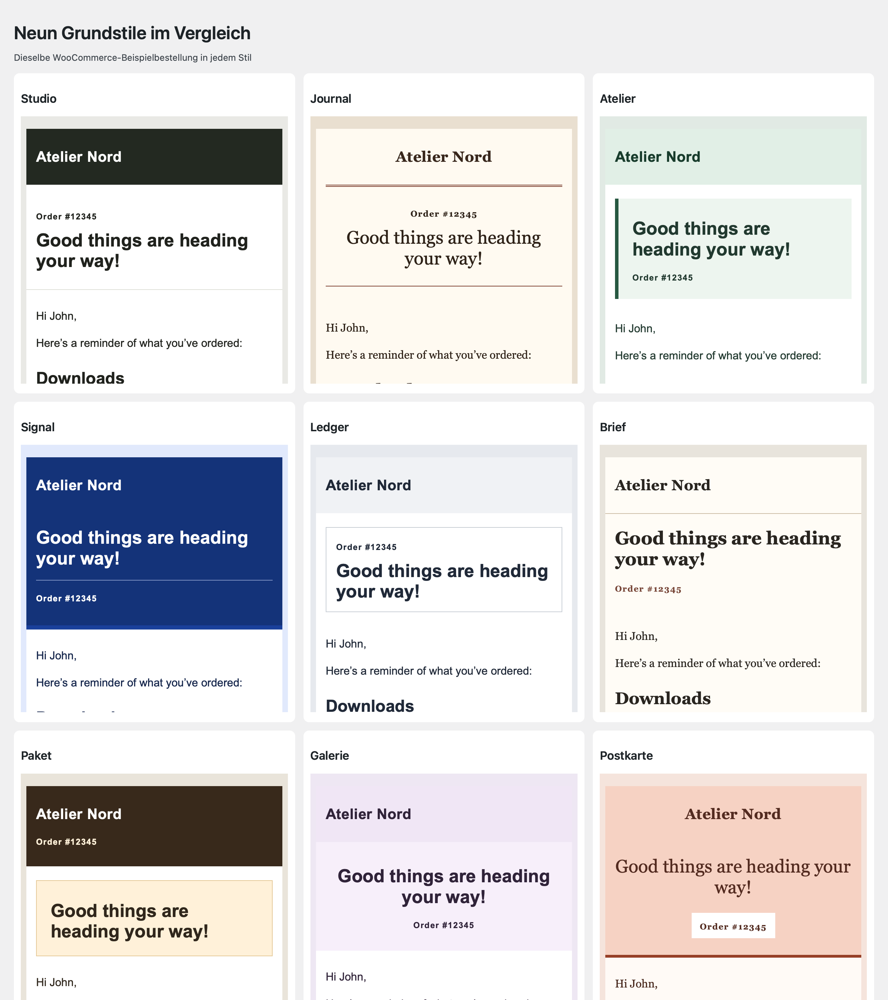
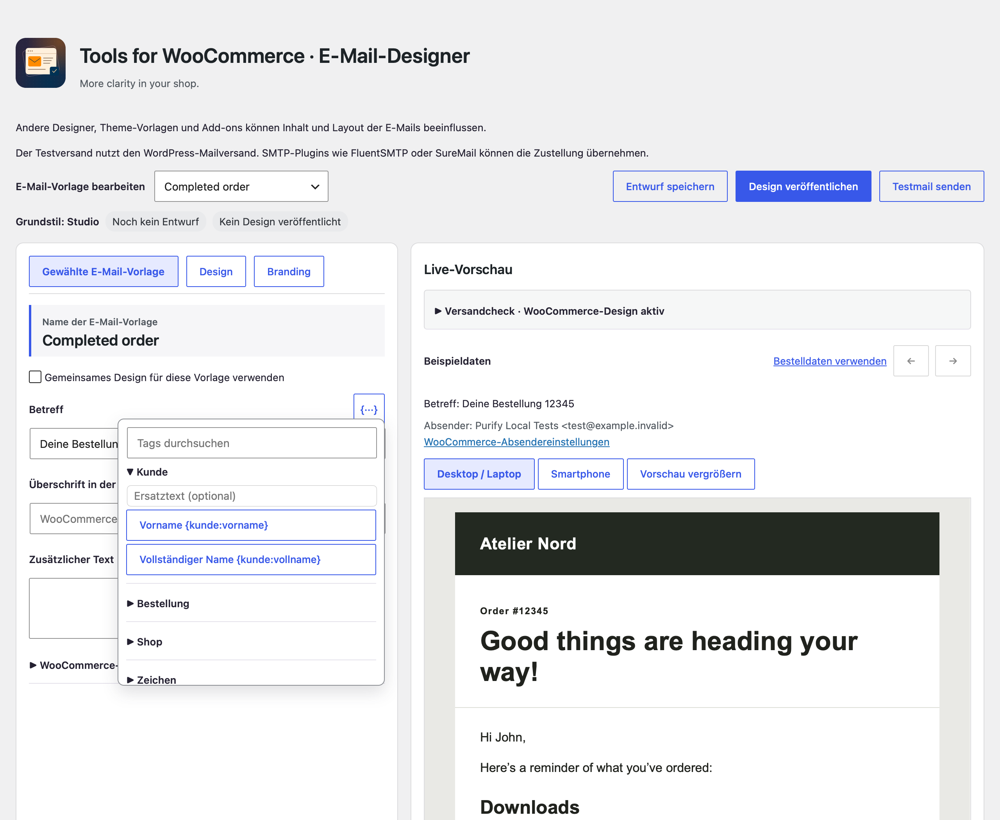
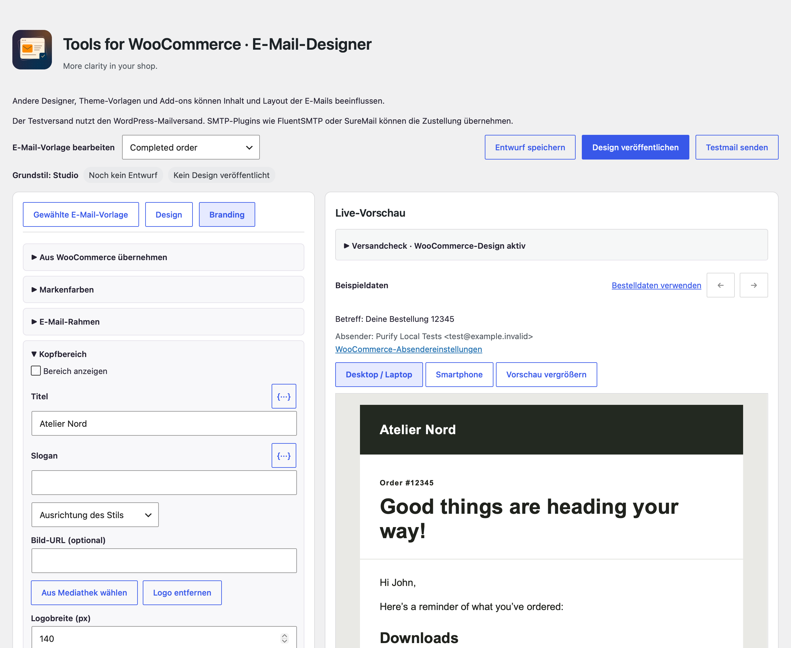

# User-guide

[Deutsch](User-guide-de)

### Tidy shop

Reduce advertising recommendations, marketing/survey notes, onboarding tasks and review prompts individually. Defaults preserve regular purchases, gateways and admin entry points. Menu visibility is separate: hiding payment menus does not disable gateways. Customers and the shared WooCommerce app remain accessible.

Under **Tidy shop → Navigation**, you can split the WooCommerce menu. Orders, customers, available payments and subscriptions, analytics and products appear in the main menu. Shop settings, classic reports and other tools appear under Management.

### Email Designer

Open the designer from the card above the TfWC settings tabs. Select an email template and a base style, insert dynamic tags in text fields and customize the header and footer under **Branding**. The preview uses sample data or order data depending on the template. Save the draft, check the desktop and smartphone previews and send a test email if needed. **Publish design** activates the design for the selected templates. WooCommerce still controls which notifications are enabled and when they are sent.

Under **Branding → Import from WooCommerce**, select saved colors, header logo, logo width, alignment and footer text to copy to the draft. The header and footer logos have separate widths. **Reset palette to base style** clears the draft’s color overrides. The preview shows the sender configured in WooCommerce. The address confirmation preview uses sample data. WooCommerce generates the confirmation link for actual notifications.

### WordPress integration

The WordPress command palette finds TfWC settings and the Email Designer when the corresponding menu is available to the signed-in account. Under **Tools → Site Health → Info**, the TfWC section lists versions, connection status, enabled shop features and whether an email design has been published.

### Transfer settings

Under **Management → Transfer settings**, choose all TfWC settings, general settings only or Email Designer only. Paste the JSON in the destination installation and review the import. Check imported email designs in the designer before publishing them. Review logos and fixed links on the destination site. The designer offers cxThemes migration assistance when it detects a suitable source.

### Free offers

The Free offers preset has physical-shipping and download variants. Applying it deliberately replaces all plugin switches; Individual retains saved values. The admin name is editable for a material-distribution service, for example.

Physical products need explicit price 0, nonvirtual/nondownloadable product settings and a real free shipping method without conditions. Shipping lines and addresses are checked; phone and account settings remain. WooCommerce normally sets these orders to Processing until dispatch.

Downloads need price 0, virtual/downloadable flags and configured files. Native download administration remains accessible. WooCommerce handles completion, permissions and delivery. Configure protection, login requirements, download limits and expiry in WooCommerce. Free variants do not allow mixed carts.

### Voluntary support

Optionally enter donation/tip information and an external link. Classic shop, product, cart, checkout and order confirmation templates can display it. Native Cart/Checkout blocks also receive the selected notice; use `[twc_support_notice]` in a Shortcode block for custom layouts. The plugin collects no payment and adds no order fee.

### Catalog

Catalog mode shows products but blocks new storefront purchases, including Store API purchases and administrators. Prices can remain visible or be hidden. An optional explanation and contact link can point to an existing contact page or inquiry form. Use `[twc_catalog_notice]` for custom layouts. No new inquiry form or archive is created. Existing orders and customer accounts remain. Clear page caches after switching modes.

### Cart Rules

Enable cart and order limits. For exactly one copy, also select Exactly one item. This allows one unit in total and overrides the other quantity/value rules.

Alternatively set minimum/maximum total order quantity, minimum/maximum quantity per product or variation, quantity increment and minimum/maximum product value. Zero means no limit; increments start at 1. The same variation split into multiple cart rows is aggregated for product limits. Amounts use product value after discounts, excluding tax, shipping and fees, in the shop currency. Minimums apply at checkout; maximum quantities/increments also apply when adding/updating items. Native quantity inputs may reflect the chosen bounds.

### Multiple websites and data

Configuration is website-local, including network activation. JSON transfer includes only plugin settings, not WooCommerce setup, products or orders. Import replaces the current configuration and requires administrator access and nonce verification. Deactivation retains all data. Uninstall retains plugin settings by default; an opt-in per-site setting removes them. Products, orders and other plugins’ data are always retained.

Order rules apply to classic WooCommerce checkout and Store API. Admin imports, custom order APIs and subscription/bundle extensions are outside a general enforcement guarantee. Test complex composite products separately.

Company-field removal and modified checkout captions target classic checkout. Block fields/captions and custom builder layouts can require their own configuration. Third-party advertising and all remote requests are not globally blocked. Late failures introduced by other plugins can leave pending orders or reservations.

The add-on remains activatable without WooCommerce: dependent store features pause and the safe settings screen remains accessible. Tested environments and limits are in the local validation report; no untested multisite or hosting guarantee.
